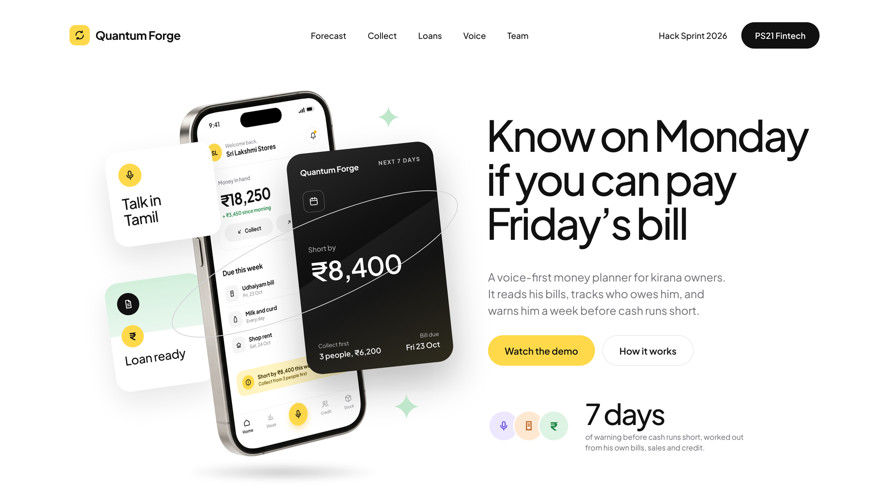
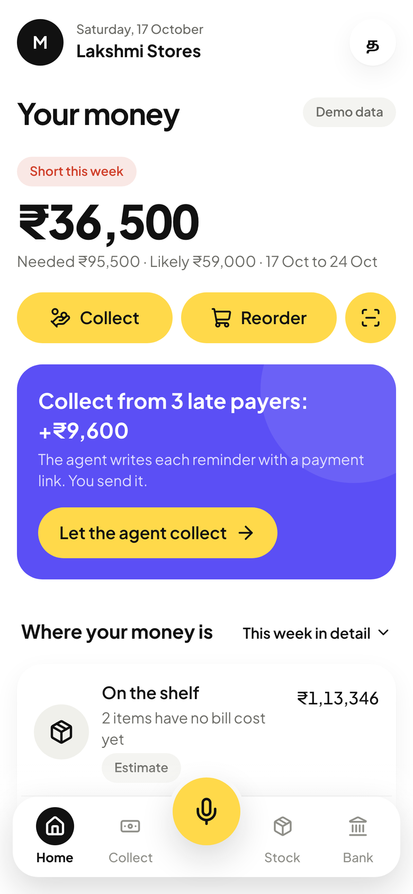
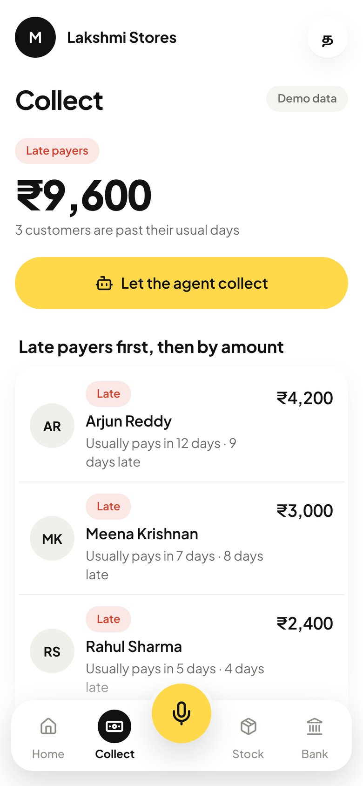
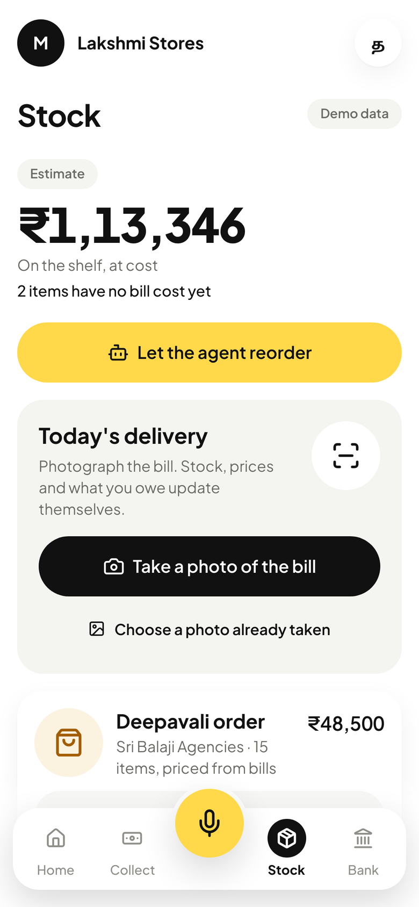
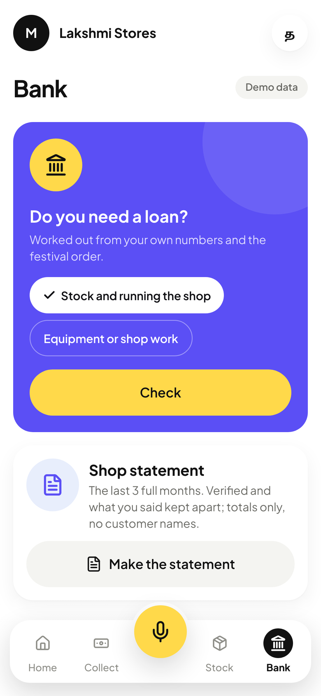
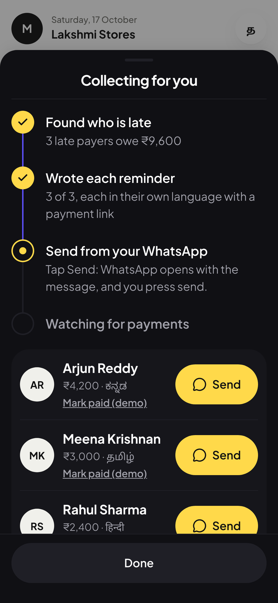
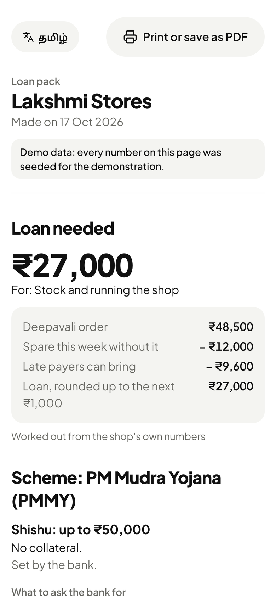
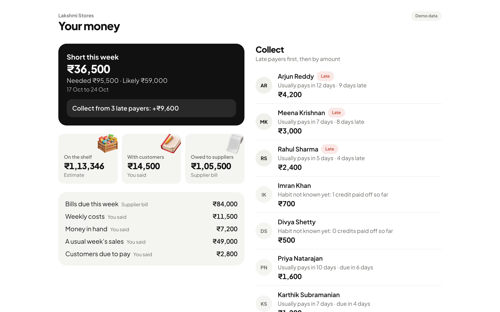
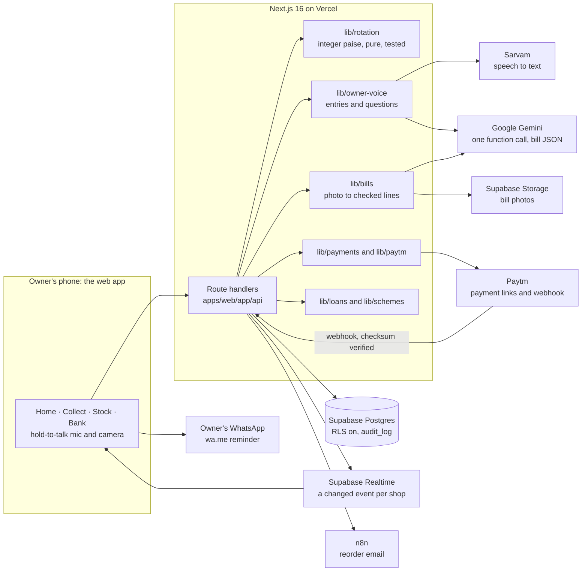

<p align="center">
  
</p>

<h1 align="center">Know on Monday if you can pay Friday's bill</h1>

<p align="center">
  <b>A voice-first money planner for kirana owners.</b><br>
  It reads his supplier bills, tracks who owes him, and warns him a week before cash runs short.<br>
  When collecting is not enough, it works out the loan he needs, the official scheme that covers it, and the pack the bank asks for.
</p>

<p align="center">
  <a href="https://github.com/ShaanGS/hacksprint/actions/workflows/ci.yml"></a>
  <a href="LICENSE"></a>
  
  
  
  
</p>

<p align="center">
  <a href="https://hacksprint-jet.vercel.app"><b>Live app</b></a> ·
  <a href="https://hacksprint-jet.vercel.app/demo"><b>Judges' screen</b></a> ·
  <a href="https://hacksprint-jet.vercel.app/video/demo.mp4"><b>Demo video (2 min)</b></a> ·
  <a href="docs/agent-system.md">Agents</a> ·
  <a href="docs/spec.md">Spec</a> ·
  <a href="docs/api.md">API</a>
</p>

<p align="center">Hack Sprint 2026 · SDG Club, MIT Bengaluru · Fintech track, problem statement PS21: measurable value for small merchants</p>

---

**Contents:** [The problem](#the-problem) · [What it does](#what-it-does) · [A week with the app](#a-week-with-the-app) · [Every number has a source](#every-number-has-a-source) · [Architecture](#architecture) · [Claims and the code behind them](#claims-and-the-code-behind-them) · [Sponsors](#sponsors-each-doing-a-real-job) · [Trust rules](#trust-rules-and-where-the-code-enforces-them) · [Measurable value](#measurable-value-ps21) · [SDGs](#sdg-fit) · [What is real and what is not](#what-is-real-and-what-is-not) · [Run it](#run-it-locally) · [Quality](#quality) · [Layout](#repository-layout) · [Team](#team)

## The problem

A kirana owner runs his shop on two kinds of credit at once. He buys stock on his distributor's credit, and the bills fall due every week. His regulars buy on credit and pay when they can. So every Monday he faces the same question with no clear answer: **will there be enough money on Friday to pay the bill?** When there is not, he borrows, often at app-loan rates.

| What we found                                             | Evidence                                                                                                                                                                                                                                                                                                                                                                                             |
| --------------------------------------------------------- | ---------------------------------------------------------------------------------------------------------------------------------------------------------------------------------------------------------------------------------------------------------------------------------------------------------------------------------------------------------------------------------------------------- |
| Money rotation, not ordering, is his daily struggle       | A shop visit in Chennai (Oct 17, 2026, one owner, on video). Stock is mostly bought on distributor credit ([Citizen Matters, 2018](https://citizenmatters.in/fmcg-distribution-system-bangalore/))                                                                                                                                                                                                   |
| Stock and credit are what owners care about most          | The same owner, and a 60 Decibels survey of kirana owners ([Flourish Ventures, 2022](https://flourishventures.com/news/why-kirana-stores-are-central-to-indias-digital-opportunity/))                                                                                                                                                                                                                |
| Short weeks are already covered by loans, at a high price | Paytm for Business lists merchant loans at 15% to 46% a year ([listing](https://play.google.com/store/apps/details?id=com.paytm.business)); public sector bank Mudra loans run 9.15% to 12.80% ([Lok Sabha answer, 2024](https://eparlib.sansad.in/bitstream/123456789/2978697/1/AS185_qg8tmE.pdf)). On a ₹50,000 one-year loan that is about ₹2,500 to ₹3,500 of interest against ₹4,200 to ₹13,300 |
| Ledger apps exist, but none forecasts the week            | OkCredit, Khatabook, Vyapar and VoiceKhata record credit, supplier dues and bills. None we checked forecasts the coming week from bills plus each customer's own repayment habit, and that is what we build                                                                                                                                                                                          |

What is still unproven is written down in [spec section 2](docs/spec.md#2-evidence-and-what-is-still-unproven): it is one shop so far, and willingness to pay is not shown.

## What it does

<p align="center">
  
  
  
  
</p>

The owner only talks and takes photos. The app has four tabs and a hold-to-talk mic.

| Tab         | What he sees                                                                                                                                                                                           | Code                                                                                                                                                                                             |
| ----------- | ------------------------------------------------------------------------------------------------------------------------------------------------------------------------------------------------------ | ------------------------------------------------------------------------------------------------------------------------------------------------------------------------------------------------ |
| **Home**    | Where his money sits (on the shelf, with customers, owed to suppliers) and this week: money needed against money likely, and "short by ₹X". Tap any number to see the bill, payment or entry behind it | [`home-tab.tsx`](apps/web/components/owner/home-tab.tsx), [`lib/rotation/forecast.ts`](apps/web/lib/rotation/forecast.ts), [`source-sheet.tsx`](apps/web/components/owner/source-sheet.tsx)      |
| **Collect** | Who to collect from first, and why ("usually pays in 12 days, 9 days late"). One tap writes a reminder in the customer's language with a payment link; he sends it from his own WhatsApp               | [`collect-tab.tsx`](apps/web/components/owner/collect-tab.tsx), [`lib/rotation/credit.ts`](apps/web/lib/rotation/credit.ts), [`lib/reminders/templates.ts`](apps/web/lib/reminders/templates.ts) |
| **Stock**   | Money on the shelf (an estimate, labelled), money stuck in slow items, items worth counting, the festival order, and the supplier bill scan                                                            | [`stock-tab.tsx`](apps/web/components/owner/stock-tab.tsx), [`lib/rotation/stock.ts`](apps/web/lib/rotation/stock.ts), [`bill-scan.tsx`](apps/web/components/owner/bill-scan.tsx)                |
| **Bank**    | The loan check, the statement a bank can read (verified and declared blocks, money cycle days) and the loan pack                                                                                       | [`bank-tab.tsx`](apps/web/components/owner/bank-tab.tsx), [`loan-check.tsx`](apps/web/components/owner/loan-check.tsx), [`lib/statement/build.ts`](apps/web/lib/statement/build.ts)              |

**Voice.** He holds the mic and speaks in Tamil or English: "Ramesh, 200 on credit", or "can I pay this week?". Sarvam turns speech into text, Gemini turns the text into one entry or one question, and a card shows what will be saved. Nothing is saved until he taps. Questions are answered from his own numbers.
[`lib/owner-voice/read.ts`](apps/web/lib/owner-voice/read.ts), [`entries.ts`](apps/web/lib/owner-voice/entries.ts), [`answers.ts`](apps/web/lib/owner-voice/answers.ts), [`voice-sheet.tsx`](apps/web/components/owner/voice-sheet.tsx)

**A planner and four agents.** The planner is Gemini: it reads the week through the shop's own typed tools, decides which steps to take and in what order, and hands back a plan that holds no numbers; code works out every amount. Each step opens the agent that does it, and the owner confirms it there. How they share context, and what the model may and may not do, is in [`docs/agent-system.md`](docs/agent-system.md). Every plan passes 8 named guardrails in code before the owner sees it, and the screen shows the check; the threat model and the attack scorecard are in [Safety and guardrails](docs/agent-system.md#safety-and-guardrails).

| Agent            | What it does                                                                                                                                                      | Code                                                                                                                                                                                         |
| ---------------- | ----------------------------------------------------------------------------------------------------------------------------------------------------------------- | -------------------------------------------------------------------------------------------------------------------------------------------------------------------------------------------- |
| Planner          | Gemini calls read-only tools (the week, late payers, bills due, stock, the loan, the bill limit) and orders the steps; the app checks the plan and adds the money | [`lib/planner`](apps/web/lib/planner), [`plan-effects.ts`](apps/web/lib/rotation/plan-effects.ts), [`plan-agent.tsx`](apps/web/components/owner/plan-agent.tsx)                              |
| Collection       | Finds the late payers, writes each reminder with a payment link, then watches for payments and ticks each one off as it lands                                     | [`collect-agent.tsx`](apps/web/components/owner/collect-agent.tsx), [`lib/reminders/remind.ts`](apps/web/lib/reminders/remind.ts), [`lib/payments/check.ts`](apps/web/lib/payments/check.ts) |
| Bill-pay         | Pays due supplier bills inside the weekly limit and the floor the owner set, from his own UPI app with his PIN; holds the rest and says why                       | [`lib/rotation/mandate.ts`](apps/web/lib/rotation/mandate.ts), [`lib/bill-pay`](apps/web/lib/bill-pay), [`pay-agent.tsx`](apps/web/components/owner/pay-agent.tsx)                           |
| Reorder          | Drafts the order for low items from his last bills, grouped by distributor, and on his tap sends it to the distributor by email through n8n                       | [`lib/reorder/plan.ts`](apps/web/lib/reorder/plan.ts), [`lib/reorder/send.ts`](apps/web/lib/reorder/send.ts), [`n8n/`](n8n/)                                                                 |
| Loan application | Fills the application from his records on screen and stops where his own Aadhaar OTP would be needed. A labelled simulation that sends nothing                    | [`apply-agent.tsx`](apps/web/components/owner/apply-agent.tsx), [`lib/loans/application.ts`](apps/web/lib/loans/application.ts)                                                              |

<p align="center">
  
  
</p>

**Judges' screen.** [`/demo`](https://hacksprint-jet.vercel.app/demo) shows the same numbers on a projector and refreshes live when a payment lands ([`app/(full)/demo/page.tsx`](<apps/web/app/(full)/demo/page.tsx>), [`live-refresh.tsx`](apps/web/components/demo/live-refresh.tsx)).

<p align="center"></p>

## A week with the app

This is the stage demo ([spec section 11](docs/spec.md#11-demo-three-acts-about-two-and-a-half-minutes)), run on the seeded demo shop, Lakshmi Stores in Chennai. Every amount comes from seeded rows and the screen labels it as demo data.

1. **He talks, the app keeps the books.** He says in Tamil "Ramesh, 200 on credit" and taps the card to save it. He photographs today's supplier bill; Gemini reads the lines, he confirms, and the bill becomes a payable with a due date. A price rise is flagged.
2. **Monday: can he pay Friday's bill?** Home says he needs ₹95,500 this week and ₹59,000 is likely to come in: **short by ₹36,500**. Three late payers owe ₹9,600. The collection agent sends their reminders; a customer pays the link, and the gap shrinks on screen while he watches.
3. **From his records to the bank.** Collecting closes only part of the gap, because of the ₹48,500 Deepavali order. The loan check works out that he needs about **₹27,000**, which is the **Mudra Shishu** band: no collateral, apply at his bank or on JanSamarth. The pack holds his statement, the stock quotation from his supplier's prices, a document checklist and official links only.

`pnpm demo:check` asserts this story against the database ([`scripts/dev/demo-check.ts`](scripts/dev/demo-check.ts)).

## Every number has a source

The model never computes or invents a number. Every amount on screen carries one of four labels and opens the rows behind it:

| Label              | Means                                                       | Example                                          |
| ------------------ | ----------------------------------------------------------- | ------------------------------------------------ |
| `verified_payment` | A payment through a payment link, confirmed by the provider | A customer's repayment through a reminder's link |
| `supplier_bill`    | Read from a supplier bill the owner confirmed               | This week's payable to Murugan Traders           |
| `owner_said`       | The owner's own words, confirmed by the owner               | "Ramesh, 200 on credit"                          |
| `estimate`         | Worked out by code from the rows above, and says "estimate" | Money on the shelf                               |

A total takes the weakest label of its parts ([`lib/rotation/labels.ts`](apps/web/lib/rotation/labels.ts)), and the rows behind each part come from [`lib/rotation/sources.ts`](apps/web/lib/rotation/sources.ts). The database refuses a `verified_payment` credit entry without a payment ([`money_rotation.sql`](supabase/migrations/20261017140000_money_rotation.sql)).

How the model is kept away from numbers:

- **Voice:** any number Gemini returns must appear in what the owner said, or it is rejected ([`lib/owner-voice/numbers.ts`](apps/web/lib/owner-voice/numbers.ts)). Answers are fixed sentences that code fills in ([`answer-words.ts`](apps/web/lib/owner-voice/answer-words.ts)).
- **Bills:** Gemini copies what is printed. The reading must pass a Zod schema and line checks ([`lib/bills/match.ts`](apps/web/lib/bills/match.ts)), and the owner confirms before anything is saved. Due dates and price-rise percentages are computed by code.
- **Money math:** integer paise in pure functions in [`apps/web/lib/rotation`](apps/web/lib/rotation), with dates in India time ([`lib/time.ts`](apps/web/lib/time.ts)). 71 unit tests cover it ([`tests/unit/rotation`](tests/unit/rotation)).

## Architecture



- **One app.** The API, the owner app, the statement and loan pack pages and the judges' screen are all one Next.js 16 app (App Router, React 19, TypeScript strict, Tailwind 4) in [`apps/web`](apps/web). Route handlers stay thin and the logic lives in [`apps/web/lib`](apps/web/lib).
- **Data.** Postgres on Supabase, schema in [`supabase/migrations`](supabase/migrations), with row level security on every table and no browser access: only the server's key reads and writes.
- **Live updates.** After every write that changes a number, the server broadcasts `changed` with the area only, and the screens refetch ([`lib/realtime.ts`](apps/web/lib/realtime.ts), [`components/owner/live.tsx`](apps/web/components/owner/live.tsx)).
- **Audit.** Every agent action and every confirmation is written to `audit_log`, and a failed audit write fails the action ([`lib/audit.ts`](apps/web/lib/audit.ts)).
- **Boundaries.** Zod checks request bodies, environment variables ([`lib/env.ts`](apps/web/lib/env.ts)) and everything a model returns. The Paytm webhook is trusted only when its checksum, merchant id and status all check out.

## Claims and the code behind them

| Claim                                                                       | Where                                                                                                                                                                                                                                                      | Status                                     |
| --------------------------------------------------------------------------- | ---------------------------------------------------------------------------------------------------------------------------------------------------------------------------------------------------------------------------------------------------------- | ------------------------------------------ |
| Where the money is: on the shelf, with customers, owed to suppliers         | [`lib/rotation/snapshot.ts`](apps/web/lib/rotation/snapshot.ts), [`stock.ts`](apps/web/lib/rotation/stock.ts), [`credit.ts`](apps/web/lib/rotation/credit.ts)                                                                                              | Real                                       |
| This week: needed against likely, short or spare                            | [`lib/rotation/forecast.ts`](apps/web/lib/rotation/forecast.ts) (`weekForecast`)                                                                                                                                                                           | Real                                       |
| Late payers judged against each customer's own habit                        | [`lib/rotation/credit.ts`](apps/web/lib/rotation/credit.ts) (`usualRepayDays`, `collectOrder`)                                                                                                                                                             | Real                                       |
| Every number labelled and traceable to rows                                 | [`lib/rotation/labels.ts`](apps/web/lib/rotation/labels.ts), [`sources.ts`](apps/web/lib/rotation/sources.ts), [`source-sheet.tsx`](apps/web/components/owner/source-sheet.tsx)                                                                            | Real                                       |
| Voice entries in Tamil, saved only on confirm                               | [`lib/sarvam/client.ts`](apps/web/lib/sarvam/client.ts), [`lib/owner-voice/read.ts`](apps/web/lib/owner-voice/read.ts), [`entries.ts`](apps/web/lib/owner-voice/entries.ts)                                                                                | Real                                       |
| Supplier bill photo read into lines, a payable and price-rise flags         | [`lib/bills/read.ts`](apps/web/lib/bills/read.ts), [`scan.ts`](apps/web/lib/bills/scan.ts), [`confirm.ts`](apps/web/lib/bills/confirm.ts)                                                                                                                  | Real                                       |
| WhatsApp reminders in Tamil, Hindi, Kannada and English                     | [`lib/reminders/templates.ts`](apps/web/lib/reminders/templates.ts)                                                                                                                                                                                        | Real; the owner presses send               |
| Payment links, a verified webhook and a server-side payment check           | [`lib/paytm/client.ts`](apps/web/lib/paytm/client.ts), [`checksum.ts`](apps/web/lib/paytm/checksum.ts), [`webhooks/paytm/route.ts`](apps/web/app/api/webhooks/paytm/route.ts), [`lib/payments/check.ts`](apps/web/lib/payments/check.ts)                   | Paytm test mode                            |
| A payment is counted once, however often it is reported                     | [`lib/payments/index.ts`](apps/web/lib/payments/index.ts) (`markPaid`), unique indexes in [`supabase/migrations`](supabase/migrations)                                                                                                                     | Real                                       |
| Reorder drafted from the last bills and emailed through n8n                 | [`lib/reorder/plan.ts`](apps/web/lib/reorder/plan.ts), [`send.ts`](apps/web/lib/reorder/send.ts), [`n8n/`](n8n/)                                                                                                                                           | Real                                       |
| Loan needed, Mudra band and registration step                               | [`lib/rotation/loan.ts`](apps/web/lib/rotation/loan.ts), [`lib/loans/ready.ts`](apps/web/lib/loans/ready.ts), [`lib/schemes/band.ts`](apps/web/lib/schemes/band.ts)                                                                                        | Real                                       |
| Scheme facts only from one catalogue with official links and a checked date | [`lib/schemes/catalog.ts`](apps/web/lib/schemes/catalog.ts)                                                                                                                                                                                                | Real                                       |
| Statement and loan pack with totals only                                    | [`lib/statement/build.ts`](apps/web/lib/statement/build.ts), [`lib/loans/pack.ts`](apps/web/lib/loans/pack.ts), [`statement page`](<apps/web/app/(full)/statement/[token]/page.tsx>), [`loan pack page`](<apps/web/app/(full)/loan-pack/[token]/page.tsx>) | Real                                       |
| The planner decides the order of steps; the model never writes an amount    | [`lib/planner/run.ts`](apps/web/lib/planner/run.ts), [`plan.ts`](apps/web/lib/planner/plan.ts), [`plan-effects.ts`](apps/web/lib/rotation/plan-effects.ts), [`tests/unit/planner.test.ts`](tests/unit/planner.test.ts)                                     | Real (Gemini), rules when it cannot answer |
| Every plan can be explained afterwards                                      | `agent_runs` and `agent_steps` ([`agent_runs.sql`](supabase/migrations/20261018000000_agent_runs.sql)), [`GET /api/agent/runs/{runId}`](apps/web/app/api/agent/runs/[runId]/route.ts)                                                                      | Real                                       |
| Bills paid only inside the owner's mandate                                  | [`lib/rotation/mandate.ts`](apps/web/lib/rotation/mandate.ts), [`tests/unit/rotation/mandate.test.ts`](tests/unit/rotation/mandate.test.ts), [`bill_pay.sql`](supabase/migrations/20261018000100_bill_pay.sql)                                             | Real; UPI step is a stand-in in demo mode  |
| Paying a bill never makes the week look better than it is                   | `moneyNow` in [`lib/rotation/forecast.ts`](apps/web/lib/rotation/forecast.ts) subtracts bills paid since the last day close                                                                                                                                | Real                                       |
| Loan application agent                                                      | [`lib/loans/application.ts`](apps/web/lib/loans/application.ts)                                                                                                                                                                                            | Simulated, and labelled so                 |
| PIN sign-in with a signed session                                           | [`lib/auth/pin-guard.ts`](apps/web/lib/auth/pin-guard.ts), [`session.ts`](apps/web/lib/auth/session.ts)                                                                                                                                                    | Real                                       |
| The demo shop, reset in one command                                         | [`rotation_demo.sql`](supabase/migrations/20261017140100_rotation_demo.sql), [`scripts/dev/demo-reset.ts`](scripts/dev/demo-reset.ts)                                                                                                                      | Demo data, labelled                        |

## Sponsors, each doing a real job

| Sponsor           | Its job here                                                                                                                                                              | Code                                                                                                                                                    |
| ----------------- | ------------------------------------------------------------------------------------------------------------------------------------------------------------------------- | ------------------------------------------------------------------------------------------------------------------------------------------------------- |
| **Paytm**         | Payment links on reminders, a checksum-verified webhook, and a server-side Fetch Transaction check, so a repayment counts as verified only once the provider confirms it  | [`lib/paytm`](apps/web/lib/paytm), [`lib/payments`](apps/web/lib/payments)                                                                              |
| **Sarvam AI**     | Speech to text for the owner's voice, in his language with English mixed in (`saaras:v4`)                                                                                 | [`lib/sarvam/client.ts`](apps/web/lib/sarvam/client.ts)                                                                                                 |
| **Google Gemini** | Plans the week over typed tools (function calling, mode ANY), turns a transcript into exactly one entry or question, and reads supplier bill photos into structured lines | [`lib/planner`](apps/web/lib/planner), [`lib/owner-voice/read.ts`](apps/web/lib/owner-voice/read.ts), [`lib/bills/read.ts`](apps/web/lib/bills/read.ts) |
| **n8n**           | Emails the reorder to the distributor from the shop's Gmail                                                                                                               | [`lib/reorder/send.ts`](apps/web/lib/reorder/send.ts), [`n8n/`](n8n/)                                                                                   |
| **Supabase**      | Postgres with row level security, Realtime for live screens, and Storage for bill photos                                                                                  | [`supabase/migrations`](supabase/migrations), [`lib/realtime.ts`](apps/web/lib/realtime.ts)                                                             |

## Trust rules and where the code enforces them

The twelve rules are [spec section 15](docs/spec.md#15-trust-privacy-and-lending-rules-never-break) and are listed in [`docs/CONTRIBUTING.md`](docs/CONTRIBUTING.md).

| Rule                                                          | Enforced in                                                                                                                                                                                                                                                                                          |
| ------------------------------------------------------------- | ---------------------------------------------------------------------------------------------------------------------------------------------------------------------------------------------------------------------------------------------------------------------------------------------------- |
| 1. The model never computes or invents a number               | [`owner-voice/numbers.ts`](apps/web/lib/owner-voice/numbers.ts), [`bills/match.ts`](apps/web/lib/bills/match.ts), fixed answer sentences in [`answer-words.ts`](apps/web/lib/owner-voice/answer-words.ts)                                                                                            |
| 2. Money math in integer paise, unit-tested                   | [`lib/rotation`](apps/web/lib/rotation), [`tests/unit/rotation`](tests/unit/rotation)                                                                                                                                                                                                                |
| 3. Nothing saved, sent or marked paid without the owner       | Pending voice entries until confirmed ([`entries.ts`](apps/web/lib/owner-voice/entries.ts)); bills confirmed in one transaction ([`bills/confirm.ts`](apps/web/lib/bills/confirm.ts)); reminders open his own WhatsApp                                                                               |
| 4. Webhooks verified and idempotent                           | [`webhooks/paytm/route.ts`](apps/web/app/api/webhooks/paytm/route.ts), `markPaid` in [`lib/payments/index.ts`](apps/web/lib/payments/index.ts)                                                                                                                                                       |
| 5. Every number labelled and linked to its rows               | [`rotation/labels.ts`](apps/web/lib/rotation/labels.ts), [`rotation/sources.ts`](apps/web/lib/rotation/sources.ts), [`source-badge.tsx`](apps/web/components/owner/source-badge.tsx)                                                                                                                 |
| 6. The owner never types                                      | No text fields in the owner app: voice, camera, a quantity stepper and the PIN keypad                                                                                                                                                                                                                |
| 7. Statements and packs carry totals only                     | Statement rows are a date and an amount ([`statement/build.ts`](apps/web/lib/statement/build.ts)); [`tests/unit/rotation/statement.test.ts`](tests/unit/rotation/statement.test.ts) checks for names                                                                                                 |
| 8. We never hold, move or lend money                          | The bill-pay agent only prepares a payment from the owner's own UPI app, inside his limit ([`rotation/mandate.ts`](apps/web/lib/rotation/mandate.ts)); the apply agent is a simulation; the reorder test payment is excluded from every number ([`rotation/load.ts`](apps/web/lib/rotation/load.ts)) |
| 9. Scheme facts only from the catalogue, with the fee warning | [`schemes/catalog.ts`](apps/web/lib/schemes/catalog.ts), shown on every loan answer and pack                                                                                                                                                                                                         |
| 10. Collect only what a feature needs                         | No contact list access; the shop profile holds only what the loan check needs                                                                                                                                                                                                                        |
| 11. The shop owns its customers' data                         | A policy for now: deletion on request is not built yet                                                                                                                                                                                                                                               |
| 12. Demo data is labelled                                     | The "Demo data" badge on every owner screen and a note on printed pages                                                                                                                                                                                                                              |

## Measurable value (PS21)

| Metric                      | How it is measured                                                                 | In the code                                                                   |
| --------------------------- | ---------------------------------------------------------------------------------- | ----------------------------------------------------------------------------- |
| Late credit recovered (₹)   | Repayments from customers past their usual days, last 30 days                      | [`rotation/value.ts`](apps/web/lib/rotation/value.ts) (`lateCreditRecovered`) |
| Money cycle days            | How long a rupee takes to go out as stock and come back as sales, against week one | [`rotation/cycle.ts`](apps/web/lib/rotation/cycle.ts) (`moneyCycleDays`)      |
| Short weeks seen in advance | Weeks flagged short at least 3 days before the bill                                | Planned; the response field exists and is empty                               |
| Loan pack time              | Minutes from "I need ₹X" to a printable pack                                       | Planned                                                                       |

## SDG fit

- **SDG 8, decent work and economic growth.** Target [8.3](https://sdgs.un.org/goals/goal8) asks for the growth of micro and small enterprises, including through access to financial services. Target [8.10](https://sdgs.un.org/goals/goal8) asks to expand access to banking and financial services for all. The weekly forecast keeps a small shop solvent, and the statement gives it records a bank can read.
- **SDG 9, industry, innovation and infrastructure.** Target [9.3](https://sdgs.un.org/goals/goal9) asks to increase small enterprises' access to financial services, including affordable credit. The loan check points the owner to Mudra, at 9.15% to 12.80% a year, instead of app loans at up to 46%.

## What is real and what is not

We would rather say it plainly than have a judge find it.

- **Paytm runs in test mode.** The integration is written in full (payment links, checksum, webhook, transaction check), but Paytm's dashboard did not issue our test keys in time. Without keys the shop runs in test mode: reminder links open the app's own test checkout ([`app/(phone)/pay/[id]`](<apps/web/app/(phone)/pay/[id]/page.tsx>)), which plays Paytm's part. A repayment made there is recorded as `verified_payment`, as Paytm's would be; its payment row keeps the provider `test`, and the checkout works only in demo mode.
- **Razorpay runs in its sandbox.** With Razorpay's test keys in, each reminder's link (and the QR the collection agent shows for it) is a real Razorpay Payment Link in test mode ([`lib/razorpay/client.ts`](apps/web/lib/razorpay/client.ts)). It is paid on Razorpay's own checkout with a test UPI id or test card, so no money moves. The agent checks the link at Razorpay with our secret key and counts the payment once Razorpay has captured the full amount. No webhook yet.
- **The bill-pay agent pays from the owner's own UPI app.** In the shop it opens his UPI app with the payee and amount filled in, and he pays with his PIN. In demo mode a stand-in sheet takes that step, because the demo distributors' UPI ids are not real.
- **The loan application agent is a simulation.** It sends nothing to any portal or lender, by design (rule 8).
- **The reorder test payment** opens a Paytm test checkout and is never counted as sales or cash.
- **Languages.** Speech is read in the shop's language with English mixed in (Tamil for the demo shop). The owner screens are in Tamil and English. Reminders go out in Tamil, Hindi, Kannada and English. Answers are shown as text, not spoken.
- **Demo data.** The demo shop's history is seeded and labelled on every screen.
- **Not built yet** (P1 in the spec): the morning alert, the nightly summary, notebook import, voice setup of weekly costs (seeded for now), an offline queue, and the micro-enterprise credit card step.
- **Customer voice ordering** (`/order`, `/qr`) was our first idea. Its code and tests are kept, frozen and out of the navigation; the owner app is the product.

## Run it locally

You need Node 24, pnpm 11, a Supabase project, and keys for Gemini and Sarvam. Paytm (staging) and n8n are optional.

```bash
pnpm install
cp apps/web/.env.example apps/web/.env.local   # then fill it in
pnpm db:reset                                  # migrations plus the demo shop (wipes the linked project)
pnpm dev
```

Then open http://localhost:3000 (the front page), http://localhost:3000/owner (the owner app; the PIN is `OWNER_PIN`) and http://localhost:3000/demo (the judges' screen). `pnpm demo:reset` restores the demo shop at any time, with dates relative to now.

| Variable                                                                                  | Needed for                                                                                |
| ----------------------------------------------------------------------------------------- | ----------------------------------------------------------------------------------------- |
| `APP_URL`                                                                                 | Links in reminders and Paytm callbacks                                                    |
| `OWNER_PIN`, `SESSION_SECRET`, `SHOP_TOKEN`                                               | Owner sign-in, session cookies, and script access                                         |
| `DEMO_MODE`, `DEMO_PAYER_PHONE`                                                           | The demo label, demo reset and the stage fallbacks; a real phone for the first late payer |
| `NEXT_PUBLIC_SUPABASE_URL`, `NEXT_PUBLIC_SUPABASE_PUBLISHABLE_KEY`, `SUPABASE_SECRET_KEY` | The database, Realtime and Storage                                                        |
| `GEMINI_API_KEY`, `GEMINI_MODEL`                                                          | Voice entries and bill reading                                                            |
| `SARVAM_API_KEY`, `SARVAM_STT_MODEL`, `SARVAM_TTS_MODEL`                                  | Speech to text                                                                            |
| `PAYTM_BASE_URL`, `PAYTM_MID`, `PAYTM_MERCHANT_KEY`                                       | Paytm payment links (optional; test mode without them)                                    |
| `RAZORPAY_KEY_ID`, `RAZORPAY_KEY_SECRET`                                                  | Razorpay payment links in its test mode (optional; used when Paytm's keys are not in)     |
| `N8N_WEBHOOK_URL`, `N8N_WEBHOOK_SECRET`                                                   | The reorder email (optional)                                                              |

Every variable is described in [`apps/web/.env.example`](apps/web/.env.example), and the app checks them with Zod at startup ([`lib/env.ts`](apps/web/lib/env.ts)).

## Quality

| Check         | Command             | What it covers                                                                                                                                                                                                                                                                                                                                                              |
| ------------- | ------------------- | --------------------------------------------------------------------------------------------------------------------------------------------------------------------------------------------------------------------------------------------------------------------------------------------------------------------------------------------------------------------------- |
| Lint          | `pnpm lint`         | ESLint with zero warnings, and Prettier                                                                                                                                                                                                                                                                                                                                     |
| Types         | `pnpm typecheck`    | Next.js route types, then TypeScript in strict mode, with no `any`                                                                                                                                                                                                                                                                                                          |
| Unit tests    | `pnpm test`         | 231 Vitest tests in [`tests/unit`](tests/unit): the weekly forecast, credit habits, stock, loan bands, statements, reorder, the bill-pay mandate, the planner's plan checks and loop, voice numbers, bill checks, Paytm checksums, sessions and more                                                                                                                        |
| End to end    | `pnpm test:e2e`     | Playwright against the running app ([`tests/e2e`](tests/e2e)): it boots, the owner signs in with the PIN, Home opens, and the week from `/api/rotation` adds up in whole paise with a source label on every part                                                                                                                                                            |
| Demo story    | `pnpm demo:check`   | Six assertions on the seeded shop: a normal week is fine, this week is short, three late payers close only part of the gap, the loan lands in Shishu                                                                                                                                                                                                                        |
| Agent evals   | `pnpm eval:planner` | The live Gemini planner on 6 fixed weeks, scored on grounding, the call budget and behaviour: collect before borrowing, never pay a held bill, no loan in a good week, honour "no loan". The last run passed 29 of 29 ([`scripts/eval`](scripts/eval), results in [`docs/agent-system.md`](docs/agent-system.md#evals))                                                     |
| Attack evals  | `pnpm eval:attacks` | 8 attacks on the live planner: orders in the owner's words, in a customer's name and in a bill photo, made-up bills and customers, a ₹5 lakh loan, and personal data. The guardrails held 8 of 8 and nothing personal reached Gemini ([`scripts/eval/red-team.ts`](scripts/eval/red-team.ts), scorecard in [`docs/agent-system.md`](docs/agent-system.md#attack-scorecard)) |
| Live services | `pnpm smoke`        | Calls Supabase, Gemini, Sarvam and Paytm with the real keys ([`scripts/smoke`](scripts/smoke))                                                                                                                                                                                                                                                                              |

[CI](.github/workflows/ci.yml) runs lint, typecheck and the unit tests on every push and pull request.

## Repository layout

```
apps/web/                  the Next.js app
  app/                     pages and route handlers (app/api)
  components/              owner app, judges' screen, printable pages, UI primitives
  lib/                     all logic: rotation, owner-voice, bills, payments, paytm,
                           reminders, reorder, loans, schemes, statement, auth
supabase/migrations/       the schema, the database functions and the demo shop
scripts/                   demo reset and check, smoke tests, stage fixtures
tests/unit/                Vitest unit tests (tests/unit/rotation for the money math)
tests/e2e/                 Playwright tests
design/                    tokens, the design rules and the visual references
docs/                      the spec, the API reference, how we work, screenshots
n8n/                       the reorder workflow
```

More: [`docs/spec.md`](docs/spec.md) (what we build and why), [`docs/api.md`](docs/api.md) (every route), [`docs/CONTRIBUTING.md`](docs/CONTRIBUTING.md) (the rules we build by), [`design/DESIGN.md`](design/DESIGN.md) (the look).

## Team

Crystal, Shaan, Thilak and Joshia, for Hack Sprint 2026 at the SDG Club, MIT Bengaluru.

## Licence

[MIT](LICENSE)
