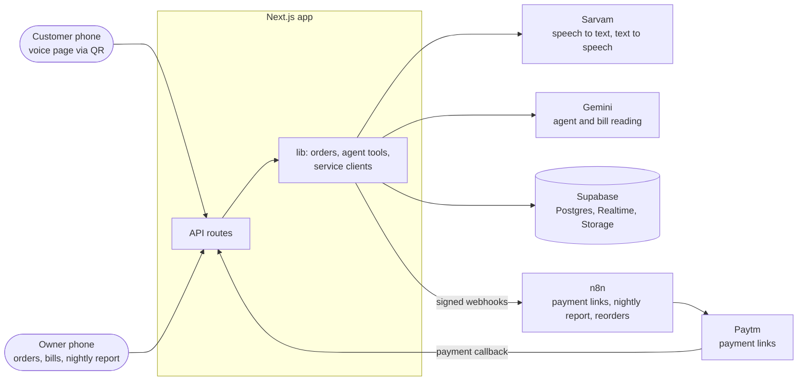
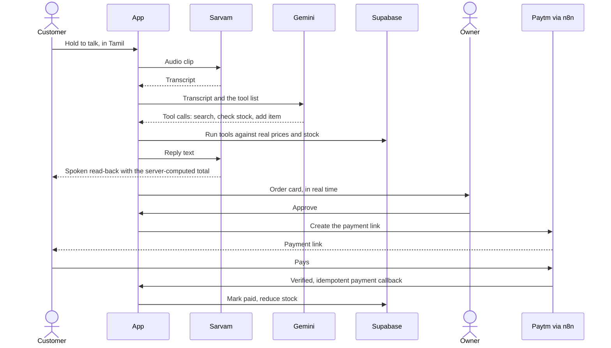

<div align="center">

# Personal Advisor for Kirana Store 

**Customers order by voice in their own language. The owner approves with one tap.<br>Payment arrives as a Paytm link or goes on the customer's account.**

<p>
  
  
  
  
  
</p>
<p>
  
  
  
  
  <a href="https://github.com/ShaanGS/hacksprint/actions/workflows/ci.yml"></a>
</p>

Hack Sprint 2026 &middot; SDG Club, MIT Bengaluru &middot; Fintech track, problem statement PS21

[The problem](#the-problem) &middot; [How it works](#how-it-works) &middot; [Architecture](#architecture) &middot; [Getting started](#getting-started) &middot; [Roadmap](#roadmap) &middot; [Full spec](docs/spec.md)

</div>

---

## The problem

A kirana owner is one person running the counter, the phone, the stock and the credit book at the same time. During the evening rush, calls go unanswered, credit goes unrecorded and stock runs out unnoticed, while quick-commerce apps win customers on convenience.

|    Signal     | Evidence                                                                                                               |
| :-----------: | ---------------------------------------------------------------------------------------------------------------------- |
|  **~2 lakh**  | kirana closures in a year, blamed on quick commerce (AICPDF, via Business Standard, Oct 2024 and TechCrunch, Nov 2024) |
|    **74%**    | of surveyed shop owners have difficulty attending to customers (Flourish Ventures / 60 Decibels)                       |
| **86% / 45%** | of 4,593 retailers name changing customer behaviour as the top challenge / want credit support (CPM India Kirana 2025) |
|    **98%**    | of Indian internet users access content in Indian languages (IAMAI-Kantar)                                             |

We don't try to beat quick commerce on speed or range. We keep what a kirana already does better (trust, credit, proximity, knowing its regulars) and take the owner out of the bottleneck.

## How it works

A normal day at the shop:

| When         | What happens                                                                                                                                                                                                                                          |
| ------------ | ----------------------------------------------------------------------------------------------------------------------------------------------------------------------------------------------------------------------------------------------------- |
| **Morning**  | The owner photographs the distributor's bill. The app reads it, and stock and prices update once the owner confirms. Nobody types a product list.                                                                                                     |
| **Daytime**  | A regular scans the shop's QR code and talks in Tamil, Hindi, Kannada, English or a mix: _"Two Maggi, one butter, half kilo sugar."_ The agent replies: _"Sugar is finished. Do you want jaggery instead?"_, then reads back the items and the total. |
| **Approval** | The order appears on the owner's phone as one card. One tap on Approve.                                                                                                                                                                               |
| **Payment**  | A Paytm payment link reaches the customer. When it's paid, stock goes down automatically. _"Put it on my account"_ records the order as credit instead.                                                                                               |
| **Night**    | The owner hears, in their language: _"14 orders today, ₹3,200 collected, two people still owe you, oil and sugar are running low. Shall I reorder?"_ On yes, the reorder goes to the distributor.                                                     |

**The core rule:** the AI only talks, listens and reads. Plain code decides what is in stock and what things cost, and the owner approves anything involving money or outgoing messages.

## Architecture



One Next.js app serves the customer voice page, the owner app and the API, and it is the only component that talks to the model or the database. A voice order flows like this:



### Each sponsor does a real job

| Sponsor       | Job in the product                                                                                  |
| ------------- | --------------------------------------------------------------------------------------------------- |
| **Sarvam AI** | Speech to text (Saaras, code-mixed Indian languages) and text to speech (Bulbul) for the voice loop |
| **Google**    | Gemini runs the conversation through function calling, and reads distributor bill photos            |
| **n8n**       | Runs side effects in order: payment link creation, the nightly report, distributor reorders         |
| **Paytm**     | Payment links and payment status callbacks                                                          |

### Guardrails

1. The model never produces a price, total or stock number. Tools read them from the database.
2. Totals are computed on the server, in one place.
3. Money and outgoing messages need the owner's approval.
4. Order status changes only through one state machine: draft, pending approval, rejected, awaiting payment, paid, on credit, delivered.
5. Payment callbacks are signature-checked and idempotent, enforced by unique indexes as well as code.
6. Every agent action is written to an audit log.

## Repository layout

```
apps/web/          Next.js app: app/ (pages and API), lib/ (env, service clients, business logic)
supabase/          schema migration, demo seed, CLI config
scripts/smoke/     one real call per external service
tests/             unit tests (Vitest) and end-to-end tests (Playwright)
n8n/               exported n8n workflows
docs/spec.md       the full product spec: problem, decisions, scope, requirements
design/            screen references and design tokens
```

## Getting started

**You need:** Node 22.12+ (24 is what Vercel runs), pnpm 11 (`corepack enable` picks the pinned version) and a Supabase account.

1. Install dependencies.
   ```bash
   pnpm install
   ```
2. Copy the env template and fill it in (variables below).
   ```bash
   cp apps/web/.env.example apps/web/.env.local
   ```
3. Create a Supabase project (Mumbai is the closest region), then log in and link it. `link` asks for the database password.
   ```bash
   pnpm exec supabase login
   ```
   ```bash
   pnpm exec supabase link --project-ref <project-ref>
   ```
4. Create the tables and load the demo shop (see the warning below).
   ```bash
   pnpm db:reset
   ```
5. Check every external service with one real call each.
   ```bash
   pnpm smoke
   ```
6. Start the app at http://localhost:3000. It refuses to start until the required variables are set, and names each missing one.
   ```bash
   pnpm dev
   ```

> [!WARNING]
> `pnpm db:reset` **wipes every table in the linked Supabase project** and reloads the demo seed. Run the hackathon demo on a **separate Supabase project**, so a reset during development can never wipe the demo.

<details>
<summary><strong>Environment variables</strong> (all in <code>apps/web/.env.local</code>)</summary>

| Variable                               | Checked             | Used for                                                      | Where to get it                                                                |
| -------------------------------------- | ------------------- | ------------------------------------------------------------- | ------------------------------------------------------------------------------ |
| `APP_URL`                              | at startup          | Public base URL: Paytm callbacks, QR codes                    | `http://localhost:3000` locally; the deployed https URL                        |
| `NEXT_PUBLIC_SUPABASE_URL`             | at startup          | Database                                                      | Supabase dashboard > Project Settings > Data API                               |
| `NEXT_PUBLIC_SUPABASE_PUBLISHABLE_KEY` | at startup          | Browser access (Realtime)                                     | Supabase dashboard > Project Settings > API Keys (`sb_publishable_...`)        |
| `SUPABASE_SECRET_KEY`                  | at startup          | Server database access; bypasses RLS, never sent to a browser | Supabase dashboard > Project Settings > API Keys (`sb_secret_...`)             |
| `GEMINI_API_KEY`                       | at startup          | Conversational agent, bill reading                            | [Google AI Studio](https://aistudio.google.com/apikey)                         |
| `GEMINI_MODEL`                         | at startup          | Model name, e.g. `gemini-3.8-flash`                           | [Gemini models](https://ai.google.dev/gemini-api/docs/models)                  |
| `SARVAM_API_KEY`                       | at startup          | Speech to text, text to speech                                | [Sarvam dashboard](https://dashboard.sarvam.ai)                                |
| `SARVAM_STT_MODEL`                     | at startup          | Speech to text model, e.g. `saaras:v4`                        | [Sarvam docs](https://docs.sarvam.ai)                                          |
| `SARVAM_TTS_MODEL`                     | at startup          | Text to speech model, e.g. `bulbul:v3`                        | [Sarvam docs](https://docs.sarvam.ai)                                          |
| `PAYTM_BASE_URL`                       | on first Paytm call | `https://securestage.paytmpayments.com` for staging           | Paytm docs                                                                     |
| `PAYTM_MID`                            | on first Paytm call | Merchant ID                                                   | [Paytm dashboard > API Keys](https://dashboard.paytmpayments.com/next/apikeys) |
| `PAYTM_MERCHANT_KEY`                   | on first Paytm call | Signs requests (16 characters)                                | [Paytm dashboard > API Keys](https://dashboard.paytmpayments.com/next/apikeys) |
| `N8N_WEBHOOK_URL`                      | on first n8n call   | Base URL of the n8n webhooks                                  | n8n workflow settings                                                          |
| `N8N_WEBHOOK_SECRET`                   | on first n8n call   | Signs webhooks between the app and n8n (32+ characters)       | `openssl rand -hex 32`                                                         |

Paytm and n8n keys are checked only when first used, because Paytm keys may arrive late. Model names live only in env, never in code.

</details>

<details>
<summary><strong>Scripts</strong></summary>

| Command                | What it does                                                                                         |
| ---------------------- | ---------------------------------------------------------------------------------------------------- |
| `pnpm dev`             | Run the app locally                                                                                  |
| `pnpm lint`            | ESLint with zero warnings allowed, plus a Prettier check                                             |
| `pnpm typecheck`       | TypeScript for the app, tests and scripts                                                            |
| `pnpm test`            | Unit tests                                                                                           |
| `pnpm test:e2e`        | End-to-end tests; needs `.env.local`, and first `pnpm exec playwright install --only-shell chromium` |
| `pnpm db:reset`        | Wipe the linked Supabase project, apply migrations and load the seed                                 |
| `pnpm smoke [service]` | One real call to Supabase, Sarvam, Gemini and Paytm, or to just one of them                          |
| `pnpm format`          | Format everything with Prettier                                                                      |

GitHub Actions runs lint, typecheck and unit tests on every push, with no secrets.

</details>

## Roadmap

The idea round is followed by a 24-hour build on October 17-18, 2026. Each milestone is the thinnest end-to-end slice of its part.

| Milestone              | Scope                                                                              | Status                              |
| ---------------------- | ---------------------------------------------------------------------------------- | ----------------------------------- |
| **1. Setup**           | Tooling, env validation, database schema, smoke tests for every service            | Built; live checks wait on API keys |
| **2. Data**            | Demo shop with 40 real products, aliases in English, Tamil, Hindi and Kannada      | Built (seeded in milestone 1)       |
| **3. Voice slice**     | QR voice page, push to talk, agent tools, order reaches the owner                  | Next                                |
| **4. Money slice**     | Owner order card, Paytm link through n8n, paid callback reduces stock, credit path | Planned                             |
| **5. Bill and report** | Bill photo to confirmed stock; nightly voice report and one-tap reorder            | Planned                             |
| **6. Demo hardening**  | Ten scripted calls per language, fallbacks, demo recording and architecture image  | Planned                             |

**Definition of done:** a judge scans a QR code, orders by voice in an Indian language, the owner approves on a second phone, the judge receives a Paytm link, paying it reduces stock, and the nightly report reflects the order.

---

<div align="center">
<sub>Built for Hack Sprint 2026 by SDG Club, MIT Bengaluru. Product name still to be decided.</sub>
</div>
