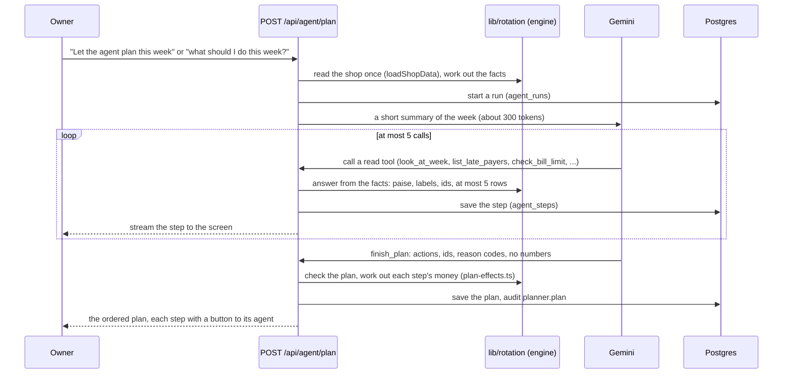

# Agents

One planner and four agents that each do one job. The planner, Gemini, decides what the owner
should do this week and in what order, by calling the shop's own tools. Each step then opens the
agent that does it, and the owner confirms it there.

The model never computes or invents a number (rule 1):

- The tools return numbers from the database.
- The plan the model hands back holds only actions, ids and reason codes.
- Code works out every amount on screen.

## The agents

| Agent            | Decides                                                       | Does                                                                     | The owner                                   | Code                                                                                                                                                                                      |
| ---------------- | ------------------------------------------------------------- | ------------------------------------------------------------------------ | ------------------------------------------- | ----------------------------------------------------------------------------------------------------------------------------------------------------------------------------------------- |
| Planner          | Which steps this week, in what order (Gemini)                 | Nothing itself: each step opens the agent that does it                   | Opens each step and decides it there        | [`lib/planner`](../apps/web/lib/planner), [`plan-agent.tsx`](../apps/web/components/owner/plan-agent.tsx)                                                                                  |
| Collection       | Who is late, against each customer's own habit (rules)        | Writes each reminder with a payment link, then watches for the payments  | Sends each message from his own WhatsApp    | [`collect-agent.tsx`](../apps/web/components/owner/collect-agent.tsx), [`lib/reminders`](../apps/web/lib/reminders)                                                                        |
| Bill-pay         | Which due bills fit inside his mandate and money in hand      | Prepares each payment from his own UPI app                               | Authorises with his UPI PIN, then confirms  | [`lib/rotation/mandate.ts`](../apps/web/lib/rotation/mandate.ts), [`lib/bill-pay`](../apps/web/lib/bill-pay), [`pay-agent.tsx`](../apps/web/components/owner/pay-agent.tsx)               |
| Reorder          | What runs out this week, at the last bill's quantity and price | Emails the order to the distributor through n8n                          | Taps Send                                   | [`lib/reorder`](../apps/web/lib/reorder), [`n8n/`](../n8n)                                                                                                                                 |
| Loan application | Nothing: a labelled simulation                                | Fills the application from his records and stops at his Aadhaar OTP      | Applies himself, at his bank or JanSamarth  | [`apply-agent.tsx`](../apps/web/components/owner/apply-agent.tsx), [`lib/loans/application.ts`](../apps/web/lib/loans/application.ts)                                                      |

## How the planner works

The pieces:

- **The loop:** [`lib/planner/run.ts`](../apps/web/lib/planner/run.ts).
  - Every call must be a tool call (function calling mode ANY), so the model never writes free
    text.
  - The fifth and last call may only call `finish_plan`.
- **The tools:** [`lib/planner/tools.ts`](../apps/web/lib/planner/tools.ts) declares them and
  runs them against the facts from [`lib/planner/facts.ts`](../apps/web/lib/planner/facts.ts).
- **The plan:** [`lib/planner/plan.ts`](../apps/web/lib/planner/plan.ts) checks it, and
  [`lib/rotation/plan-effects.ts`](../apps/web/lib/rotation/plan-effects.ts) works out the week
  after each step, in integer paise.
- **The rules planner:** when Gemini cannot answer (no key, a timeout, the daily limit), the
  rules in [`lib/planner/fallback.ts`](../apps/web/lib/planner/fallback.ts) plan the same way,
  and the screen says "Planned by rules".
- **The run record:** [`GET /api/agent/runs/{runId}`](api.md) returns a run with every tool call
  and result, so anyone can see why it decided.

## The harness

The harness is everything around the model that turns it from something that answers into
something that acts: the loop, the tools, how its context is built and kept small, memory,
guardrails, the people in the loop, tracing and evals. Ours is small, and every part of it is
in this repo.

| Part                | What it does                                                                                                | Code                                                                                                                                                                  |
| ------------------- | ----------------------------------------------------------------------------------------------------------- | --------------------------------------------------------------------------------------------------------------------------------------------------------------------- |
| Loop and budgets    | At most 5 model calls a run, each with an 8 s deadline; every call must be a tool call; the last may only finish | [`run.ts`](../apps/web/lib/planner/run.ts), [`gemini.ts`](../apps/web/lib/planner/gemini.ts)                                                                          |
| Tools               | 6 read tools and `finish_plan`, answered from one read of the shop                                          | [`tools.ts`](../apps/web/lib/planner/tools.ts), [`facts.ts`](../apps/web/lib/planner/facts.ts)                                                                       |
| Context             | Write, select, compress and isolate (below)                                                                 | [`facts.ts`](../apps/web/lib/planner/facts.ts), [`record.ts`](../apps/web/lib/planner/record.ts)                                                                     |
| Guardrails          | No numbers or free text in the plan; ids must have been shown; preconditions; the owner's own bill limit    | [`plan.ts`](../apps/web/lib/planner/plan.ts), [`mandate.ts`](../apps/web/lib/rotation/mandate.ts)                                                                    |
| People in the loop  | Each step opens the agent that does it, and the owner confirms there; payments need his UPI PIN             | [`plan-agent.tsx`](../apps/web/components/owner/plan-agent.tsx), [`pay-agent.tsx`](../apps/web/components/owner/pay-agent.tsx)                                       |
| Tracing             | Every run, model call, tool call and result is saved; the screen links to the run record                    | `agent_runs`, `agent_steps` ([`agent_runs.sql`](../supabase/migrations/20261018000000_agent_runs.sql)), `GET /api/agent/runs/{runId}`                                |
| Telemetry           | Tokens in, out and thinking for every call, summed per run and shown on the plan                            | [`start.ts`](../apps/web/lib/planner/start.ts)                                                                                                                         |
| Evals               | `pnpm eval:planner` runs the live model on 6 fixed weeks and scores it; the last run passed 29 of 29        | [`scripts/eval`](../scripts/eval)                                                                                                                                     |
| Failure             | When the model fails, times out or hits its rate limit, fixed rules plan instead and the screen says so     | [`fallback.ts`](../apps/web/lib/planner/fallback.ts)                                                                                                                  |

### Context: write, select, compress, isolate

- **Write: memory lives outside the context.**
  - Every run, model call, tool call and result is saved (`agent_runs`, `agent_steps`).
  - The next run gets one line about the last plan: what it asked, and how many of the late
    payers it named have paid since (`lastPlan` in
    [`record.ts`](../apps/web/lib/planner/record.ts)).
  - No conversation history is carried between runs, so a run's context never grows with use.
- **Select: only what the model asks for.**
  - A run starts from a summary of about 300 tokens (`summaryOf` in
    [`facts.ts`](../apps/web/lib/planner/facts.ts)).
  - Detail comes only through a tool: whole paise, source labels, ids, at most 5 rows, never a
    phone number.
  - Detail the model does not ask for never enters the context.
  - Only 7 small tools are declared, so their definitions stay cheap.
- **Compress: typed facts, not raw data.**
  - Tools answer with the engine's results, not database rows: one week's money, not a ledger.
  - The shop is read once per run, and every tool answers from that same read, so two tools
    never disagree because a payment landed between them.
  - A whole planning run measures about 2,500 to 5,900 tokens of context across 2 to 4 calls
    (`pnpm eval:planner`).
- **Isolate: agents never share a context.**
  - A specialist agent (collect, pay, reorder) gets only ids from the plan and re-reads the shop
    itself. The planner never sees its workings, and it never sees the planner's.
  - Stale context is refused rather than acted on:
    - the reorder answers 409 "The list changed. Look again." when the list moved since the
      owner looked;
    - the bill-pay agent re-decides a bill when the owner marks it paid, and refuses it if it no
      longer fits.
  - Shared state is the database: every write that changes a number broadcasts `changed` for
    the shop, and the screens refetch.

### Grounding

A plan step may only point at ids a tool showed in this run, and only when its precondition
holds:

- a late payer exists;
- a bill is marked "pay";
- a bill marked payable only if the late payers pay first comes after a collect step;
- the loan is needed.

Anything else is dropped, and the drop is recorded (`checkPlan` in
[`plan.ts`](../apps/web/lib/planner/plan.ts)).

Only the tool that allows an action hands out ids for it:

- a customer id comes from `list_late_payers`;
- a bill id comes from `check_bill_limit`, which applies the owner's limit;
- a distributor id comes from `check_stock`;
- the festival order's id comes from `check_loan`.

`list_bills_due` shows what is due without ids, so the model cannot pick a bill the limit holds.
The eval below found that gap.

### Evals

`pnpm eval:planner` ([`scripts/eval`](../scripts/eval)) runs the live planner (Gemini, the same
loop and tools as the app) on six fixed weeks:

- the demo week before and after collecting;
- a good week;
- no bill limit set;
- stock running out;
- an owner who says he wants no loan.

Every week must pass three checks: the model answered, nothing it planned was dropped, and it
stayed inside 5 calls. Each week also has its own behaviour checks:

- collect before paying or borrowing;
- pay the bill the limit allows;
- no loan in a good week;
- no bill paid without a limit;
- reorder what runs out;
- honour "no loan".

What the evals found, and what changed:

| Run | Score    | What happened                                                                                                                                                                                                       |
| --- | -------- | ------------------------------------------------------------------------------------------------------------------------------------------------------------------------------------------------------------------- |
| 1   | 28 of 29 | In the good week the model planned to pay a bill the owner's own limit held. The guard dropped it, so no owner would have seen it, but the plan was wrong.                                                          |
| 2   | 28 of 29 | First fix: `check_bill_limit` stopped giving ids for held bills. Same failure, because `list_bills_due` still showed every bill's id.                                                                              |
| 3   | 29 of 29 | The fix that held: only the tool that allows an action hands out ids for it. `list_bills_due` now shows what is due without ids, so a bill reaches a plan only through `check_bill_limit`. One prompt line matches. |

- **The scorecard shows which tools each week used.** In the good week the model read the week,
  the bills and the limit, then planned nothing, which is right: nobody is late and no bill fits
  the limit yet.
- **A week cost 2 to 4 calls and about 2,500 to 5,900 tokens of context,** across all three
  runs, in 1.4 to 4 seconds of model time.
- **One clean run is not proof.** The model varies from run to run, so the guard stays: a wrong
  step is still dropped and recorded before it reaches the owner.

## Numbers never pass through the model

- **Planner:** the `finish_plan` schema has no number or free-text fields. Amounts come from
  the facts, and `plan-effects.ts` (tested in
  [`plan-effects.test.ts`](../tests/unit/rotation/plan-effects.test.ts)) works out the gap and
  money in hand after each step.
- **Voice:** any number Gemini reads from speech must appear in what the owner said
  ([`owner-voice/numbers.ts`](../apps/web/lib/owner-voice/numbers.ts)). Answers are fixed
  sentences filled in by code.
- **Bills:** Gemini copies what is printed. The reading must pass a Zod schema and line checks
  ([`bills/match.ts`](../apps/web/lib/bills/match.ts)), and the owner confirms it.

## AI payments under a mandate

The owner gives the bill-pay agent a standing mandate, set by tapping chips. He never types it:

- a weekly limit, ₹10,000, ₹25,000 or ₹50,000;
- an amount to always keep in hand, ₹1,000, ₹2,000 or ₹5,000.

The rules are in [`lib/rotation/mandate.ts`](../apps/web/lib/rotation/mandate.ts), pure and
unit-tested, and they decide each due bill:

- **Which bills it looks at:** supplier bills he confirmed, due within 2 days or overdue.
  Overdue bills come first.
- **Pay** only when the bill fits inside the weekly limit (counting what the agent paid in the
  last 7 days) and inside money in hand minus the floor.
- **Hold**, with the reason in plain words, for:
  - over the limit;
  - not enough in hand, saying how much more is needed;
  - no UPI id for the distributor;
  - not due yet;
  - the festival order, which the loan is for.
- It never pays part of a bill.

**The rail.** A payment is a UPI intent: the owner's own UPI app opens with the payee, the
amount and the bill number filled in. He authorises it with his PIN, then taps "I paid it".

- We never hold or move the money (rule 8).
- Paytm payment links cannot do this job, because they collect money into the shop's merchant
  account. Paying from our account would need Paytm Payouts.
- The app re-decides the bill when he marks it paid, records it as his word (`owner_said`),
  links it to the agent's run, and audits it.

**Where this goes.** The mandate has the shape the industry is converging on: a standing
authorisation with limits, and an agent acting inside it.

- NPCI is reported to be building an agent protocol for UPI on UPI Circle (delegated payments)
  and Reserve Pay (pre-blocked funds), after a Razorpay, NPCI and OpenAI pilot in 2025. Google's
  AP2 uses mandates in the same way.
- When agent payments open to merchants, the same mandate can authorise small payments without
  a PIN each time. The rules that decide what may be paid stay as they are.

**A forecast fix that came with it.** Money in hand is the last day-close figure plus verified
payments received since. It now also subtracts bills paid since, so paying a bill no longer makes
the week look better than it is.

## What is simulated

- **The demo shop's UPI step.** In demo mode the UPI step is a stand-in sheet ("Your UPI app
  opens here. Demo: no money moves"), because the demo distributors' UPI ids are not real.
- **Paytm.** It runs in test mode until live keys are issued; see the README.
- **The loan application agent.** It is a simulation by design, so we never act as a lending
  service provider.

## Questions we expect

**Is the AI just a wrapper?**

The model decides what to look at and in what order to act; the run record shows it choosing
different tools on different runs. What it reasons over is our own engine (`lib/rotation`):

- each customer's own repayment habit;
- the weekly forecast from bills and sales;
- stock estimates;
- loan sizing against Mudra bands.

All of it is in integer paise with 231 unit tests. The model can choose; it cannot change a
number.

**What if the model plans something wrong?**

- The plan is checked: unseen ids and failed preconditions are dropped and recorded.
- Every step needs the owner's own confirmation in its agent.
- If the model fails, fixed rules plan instead, and the screen says so.

**What stops the bill-pay agent from overspending?**

- The mandate rules in code, re-checked when the bill is marked paid.
- The owner's UPI PIN on every payment.
- The floor he keeps in hand.
- The audit log.

**How would this scale to more agents?**

- Each agent is a loop over its own small set of tools, reading the same facts, with its own
  turn budget.
- Shared memory is the database, and coordination is by ids and `changed` events.
- No agent passes its context to another.

**What does a plan cost?**

In the evals, 2 to 4 Gemini Flash-Lite calls and about 2,500 to 5,900 tokens of context, with
the screen streaming each step as it happens. The cap is 5 calls. With no model available, the
rules plan costs nothing.
